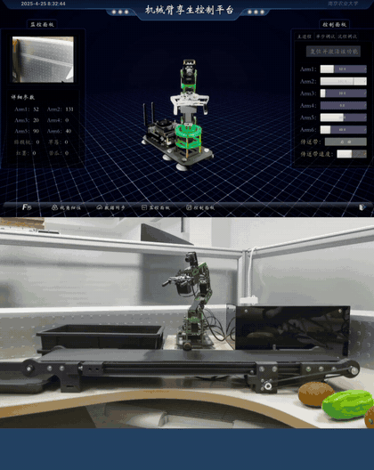
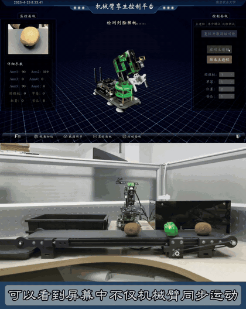
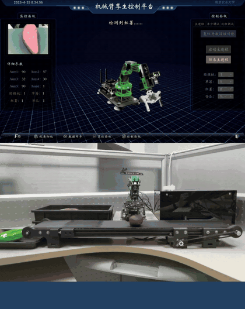

# Robotic Arm Digital Twin Platform

**Undergraduate Capstone Project**

I independently designed and built this robotic arm digital twin platform from scratch for my undergraduate capstone. The demos show the 3D interface alongside the physical arm and conveyor, with the digital twin reflecting the arm's motion during pick-and-place and sorting.

**Full demo video** · [Download the original recording](https://github.com/SuyuanYY/robotic-arm-digital-twin/releases/download/v1.0/robotic-arm-digital-twin-platform.mp4) (3 min 19 sec).

### Arm Motion and Digital Twin

The arm changes its joint configuration while the 3D view mirrors the motion.

### Conveyor Pick and Place

The arm grasps an item from the conveyor, rotates and places it in the sorting tray.

### Sorting Cycle

The arm sorts another item and returns to its ready position.

